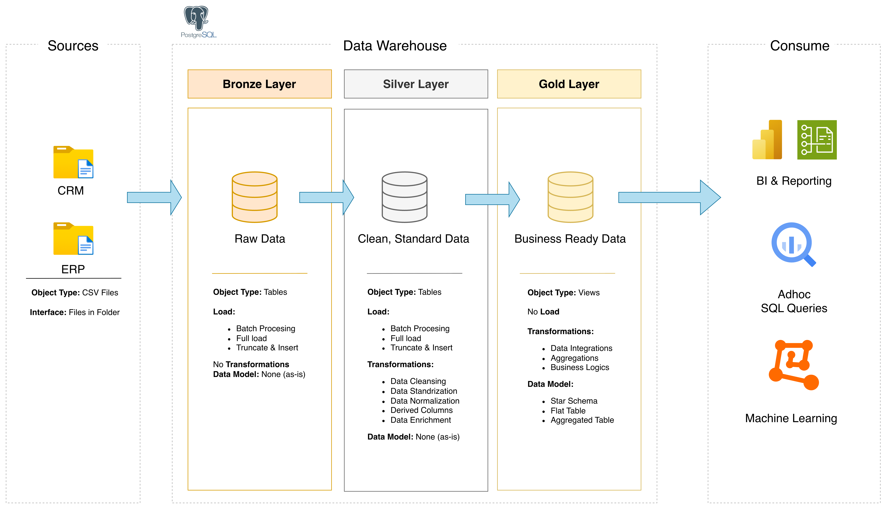
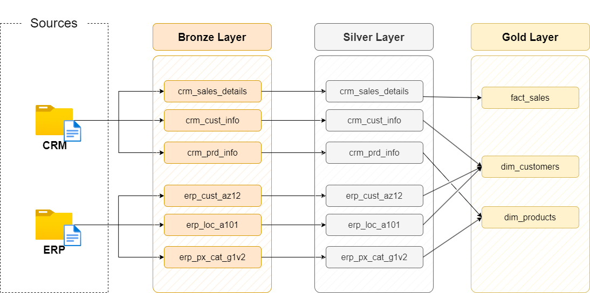

# Data Warehouse and Analytics Project
Welcome to the **Data Warehouse and Analytics Project** repository! 🚀

This project demonstrates a comprehensive data warehousing and analytics solution, from building a data warehouse to generating actionable insights. Designed as a portfolio project highlights industry best pratices in data engineering and analytics.

---


## 🚀 Project Requirements

### Building the Data Warehouse (Data Engineering)

### Objective
Develop a modern data warehouse using PostgreSQL to consolidate sales data, enabling analytical reporting and informed decision-making.

### Specifications
- **Data Sources**: Import data from two source systems (ERP and CRM) provided as CSV files
- **Data Quality**: Cleanse and resolve data quality issuse prior to analysis.
- **Integration**: Combine both sources into a single, user-friendly data model designed for analytical queries.
- **Scope**: Focus on the latest dataset only; historization of data is not required.
- **Documentation**: Provide clear documentation of the data model to support both business stakeholders and analytics teams.

---

### BI: Analytics & Reporting (Data Analytics)

### Objective
Develop SQL-based analytics to deliver detailed insights into:
- **Customer Behavior**
- **Product Performance**
- **Sale Trends**

These insights empower stakeholders with key business metrics, enabling strategic decision-making.

--- 

## 📁 Project Structure
The project is organized into the following directories to separate source datasets, documentation, SQL scripts, and data quality tests.
```
sql-data-warehouse-project/
├── datasets/               the six source files the project loads
│   ├── source_crm/         three files from the CRM system
│   └── source_erp/         three files from the ERP system
├── docs/                   the requirements, the diagrams and the notes
├── scripts/                the project scripts, in the order of the videos
│   ├── init_database.sql   creates the database: run it first
│   ├── init_schema.sql     creates the schema
│   ├── bronze/             loads the raw files
│   ├── silver/             cleans and prepares the data
│   └── gold/               builds the tables for analysis
└── tests/                  checks the quality of the **Silver** and **Gold** data
```

---
## 🏗️ Data Architecture

The data architecture for this project follows Medallion Architecture **Bronze**, **Silver**, and **Gold** layers:


1. **Bronze Layer**: Stores raw data as-is from the source systems. Data is ingested from CSV files into a PostgreSQL database.
2. **Silver Layer**: This layer includes data cleansing, standardization, and normalization processes to prepare data for analysis.
3. **Gold Layer**: Houses business-ready data modeled into a star schema required for reporting and analytics.

---
## 🏛️ Building the Data Warehouse


The warehouse is built in sequence: **Bronze** ingests source data, **Silver** cleans and standardizes it, and **Gold** will provide the business-ready model for analytics. The SQL scripts in this project use PostgreSQL.

### Building Bronze Layer

The **Bronze** layer stores source data with minimal transformation. Run the scripts in `scripts/bronze/` to create the raw tables and load the CRM and ERP CSV files.

1. Create the database with [`init_database.sql`](scripts/init_database.sql), then connect to the `datawarehouse` database. **Warning:** this script drops and recreates the database if it already exists.
2. Create the schemas by running [`init_schema.sql`](scripts/init_schema.sql).
3. Create the **Bronze** tables with [`ddl_bronze.sql`](scripts/**Bronze**/ddl_bronze.sql).
4. Create the load procedure with [`proc_load_bronze.sql`](scripts/**Bronze**/proc_load_bronze.sql), then load the files by running `CALL bronze.load_bronze();`.

The load procedure uses local file paths in its `COPY` commands. Update those paths to match where the CSV files are stored on your machine before running it.

### Building Silver Layer

The **Silver Layer** transforms **Bronze** data by cleaning, standardizing, and preparing it for downstream analysis. Run the scripts in `scripts/silver/` after **Bronze** has loaded successfully.

1. Create the **Silver** tables with [`ddl_silver.sql`](scripts/silver/ddl_silver.sql).
2. Create the transformation procedure with [`proc_load_silver.sql`](scripts/silver/proc_load_silver.sql), then populate **Silver** by running `CALL silver.load_silver();`.
3. Run [`quality_checks_silver.sql`](tests/quality_checks_silver.sql) to inspect data quality, including nulls, duplicates, unwanted spaces, and invalid values in the **Bronze** and **Silver** tables.

### Building Gold Layer

The **Gold Layer** presents business-ready data in a star schema, built from the cleansed **Silver Layer**. In this project, the **Gold** objects are PostgreSQL views, so they expose the analytical model without storing a separate copy of the data. See the [Sales Data Mart star schema](docs/data_model.png).

- `gold.dim_customers` combines CRM customer attributes with ERP country, birthdate, and gender data. It assigns a surrogate `customer_key` for analysis.
- `gold.dim_products` combines CRM product attributes with ERP category details and includes only current products (`prd_end_dt IS NULL`). It assigns a surrogate `product_key`.
- `gold.fact_sales` provides sales order dates, shipping and due dates, sales amount, quantity, and price, linked to the customer and product dimensions.

After the **Silver** tables have been loaded, build and validate the **Gold Layer**:

1. Run [`ddl_gold.sql`](scripts/gold/ddl_gold.sql) to create the customer and product dimensions and the sales fact view.
2. Run [`quality_checks_gold.sql`](tests/quality_checks_gold.sql). The duplicate-key checks should return no rows, and the fact-to-dimension relationship check should also return no unmatched sales rows.

The views read from **Silver**, so rerun the quality checks after refreshing the **Silver** data.